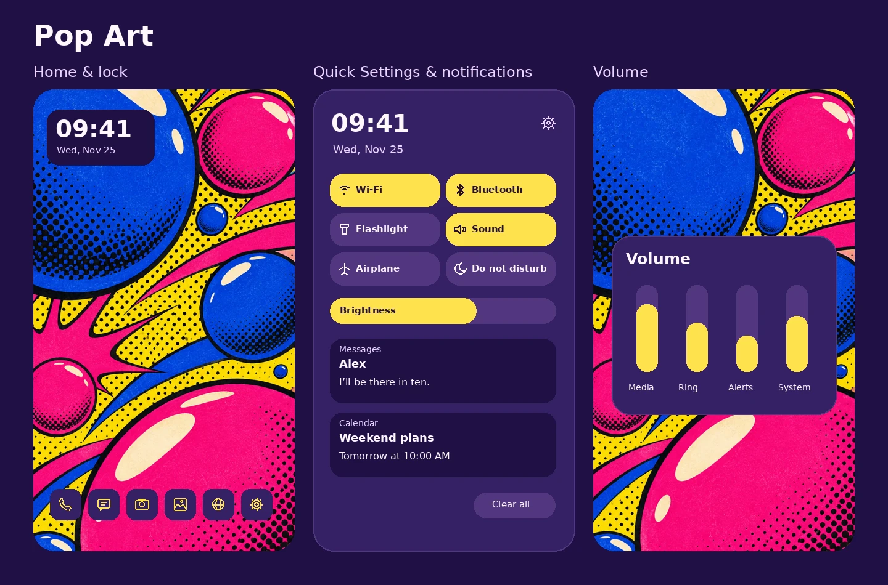

# Pop Art

Cobalt ink, hot pink, and lemon-yellow halftones.

## Assets

- [Wallpaper](wallpaper.webp). 1440 × 3120 portrait wallpaper.
- [App icons](icons/). Six 512 × 512 PNGs for Phone, Messages, Camera, Gallery, Browser, and Settings.
- [Palette](palette.json). Color values for manual setup. The preview illustrates the intended surfaces.

## Galaxy setup

1. Download the wallpaper, then open it in Samsung Gallery and use **Set as wallpaper** to select your home screen, lock screen, or both.
2. In **Good Lock → Theme Park → Theme**, create a theme using the wallpaper and set its main accent to `#FFE34C`. Preview and apply the theme on your device.
3. Open **Theme Park → Quick panel**. Where the editor exposes the corresponding fields, use `#352064` for the panel, `#FFE34C` and `#523780` for enabled and disabled controls, `#201045` for notification cards, and `#FFF7FD` for text.
4. Open **Theme Park → Volume panel** if your version includes it. Use `#352064` for the panel, `#FFE34C` for the filled slider, `#523780` for the track, and `#FFF7FD` for text wherever available. Save and apply the panel. Some versions expose fewer colors or arrange the panel differently.
5. In **Theme Park → Icon**, use individual app icon editing where supported and select the matching PNG from Gallery. Save and apply the icon set.

Theme Park controls and availability vary by Galaxy model, region, Good Lock version, and One UI version. These are downloadable assets for manual setup. The preview is a design illustration. Installation and system panel customization have yet to be verified on a physical Galaxy device.
